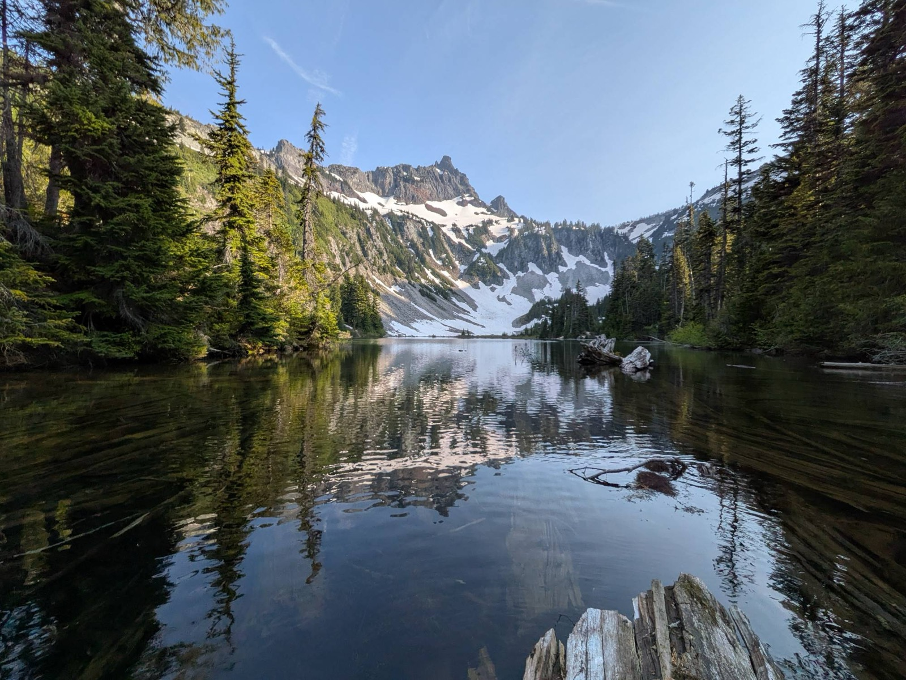
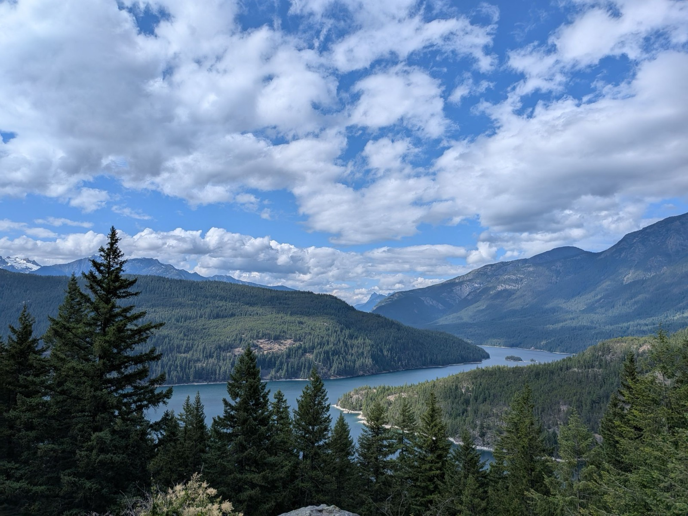
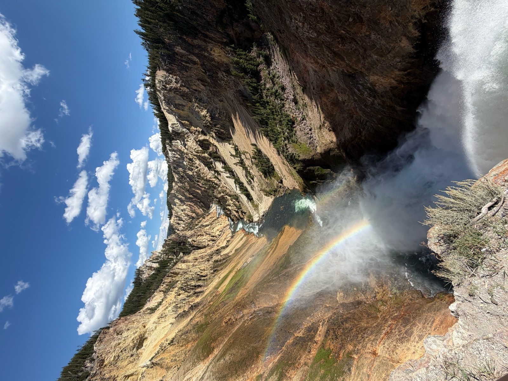
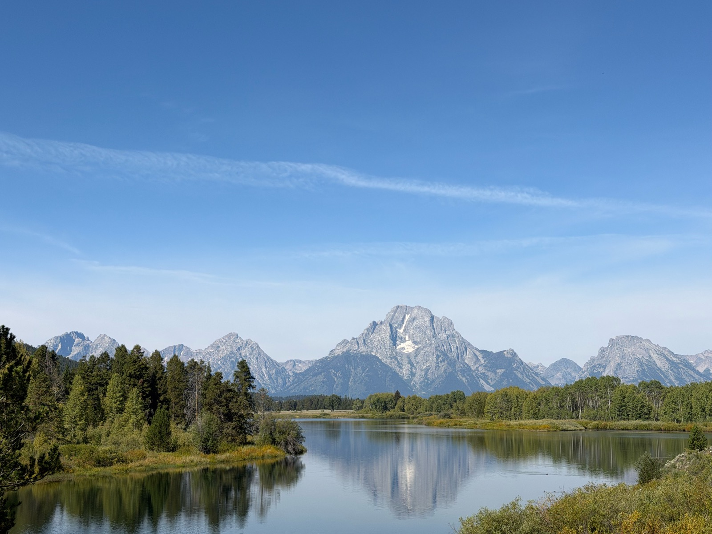
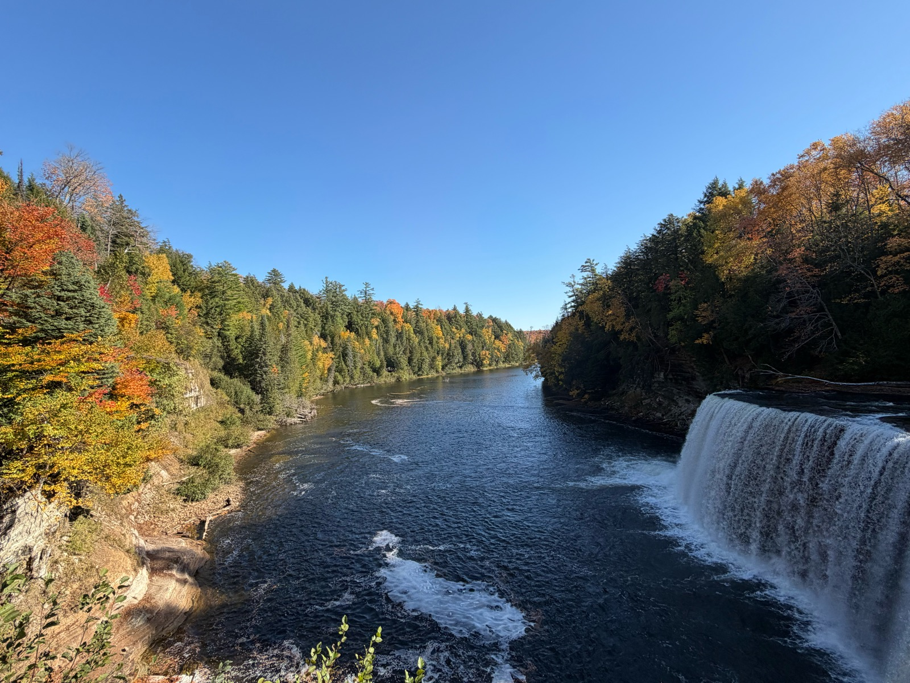
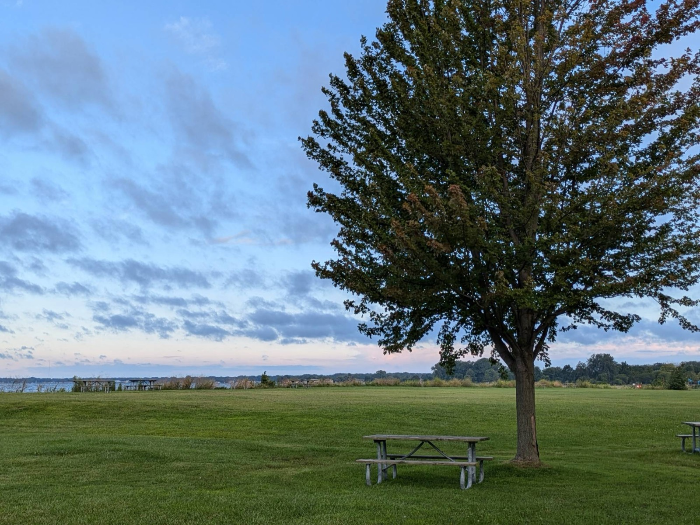
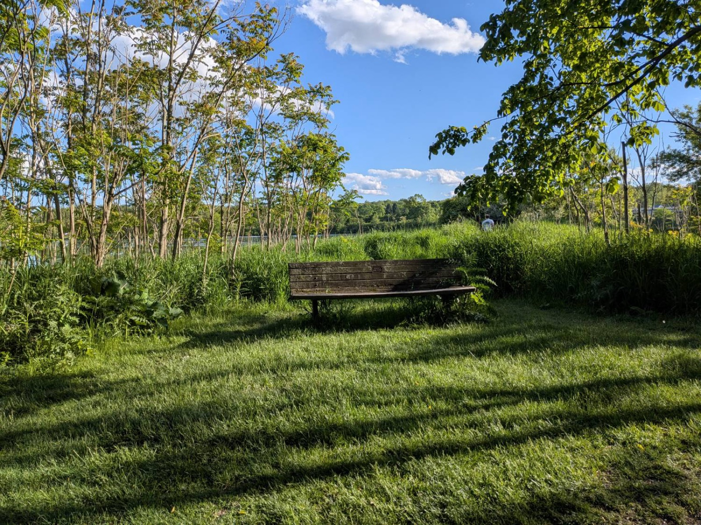

<!-- To add a photo: drop it in images/photos/ and add one line below.
     Format: {group="photos" fig-alt="Description"} -->

::: {.photo-grid}

{group="photos" fig-alt="Snow-capped mountain range above a layer of low cloud, with evergreen trees in the foreground"}

{group="photos" fig-alt="Looking straight up from a rocky gorge at a sky of rippled clouds, framed by evergreen and autumn trees"}

{group="photos" fig-alt="A maple tree turning red and orange against a clear blue sky, beside an empty parking lot"}

{group="photos" fig-alt="A still alpine lake reflecting a jagged, snow-streaked peak, framed by tall evergreens"}

{group="photos" fig-alt="A long blue lake winding between forested mountains under a sky full of white clouds"}

{group="photos" fig-alt="A waterfall plunging into a deep yellow-walled canyon, with a rainbow in its spray"}

{group="photos" fig-alt="A granite mountain range reflected in a calm river bend lined with green trees"}

{group="photos" fig-alt="A wide river flowing past autumn forest in red, orange and gold, with a waterfall on the right"}

{group="photos" fig-alt="A lone tree and picnic table on a lakeside lawn under a blue evening sky with soft clouds"}

{group="photos" fig-alt="A wooden bench in a sunlit grassy clearing surrounded by young trees and tall grass"}

:::
