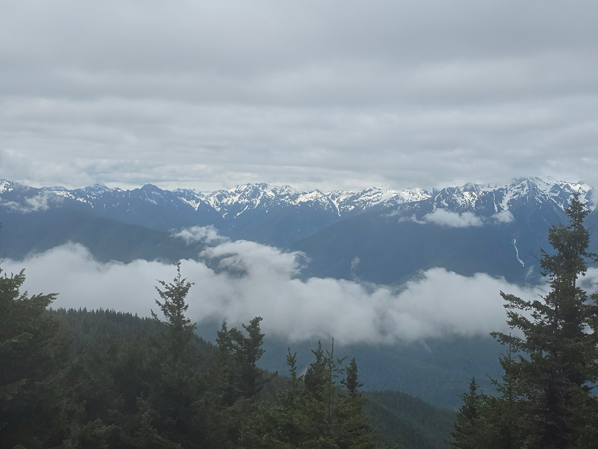
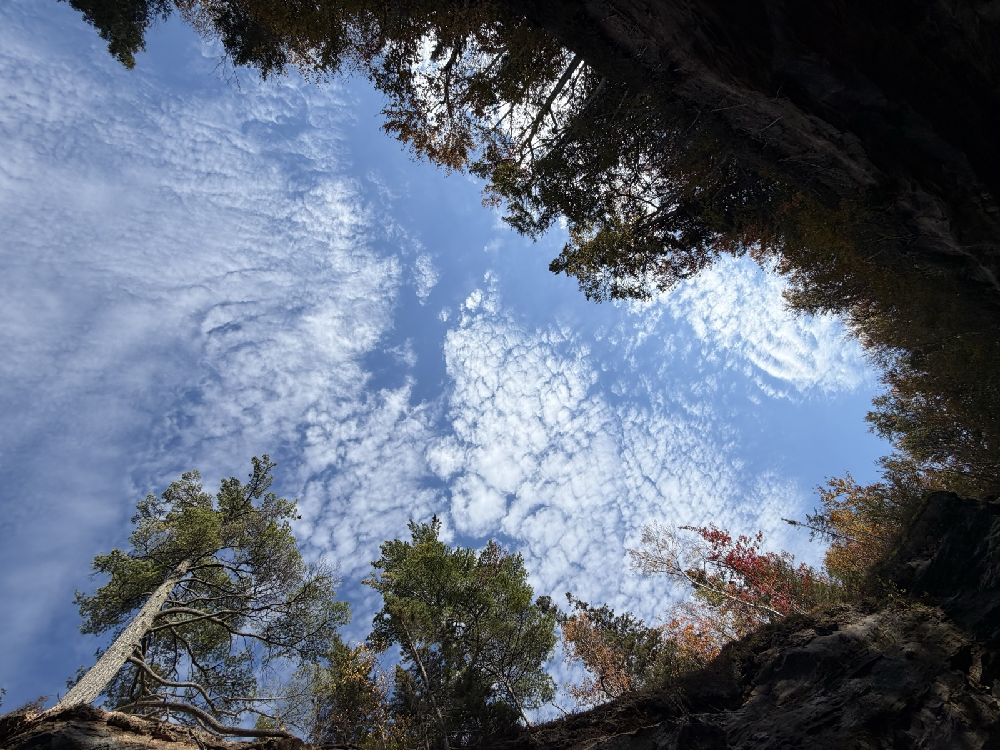
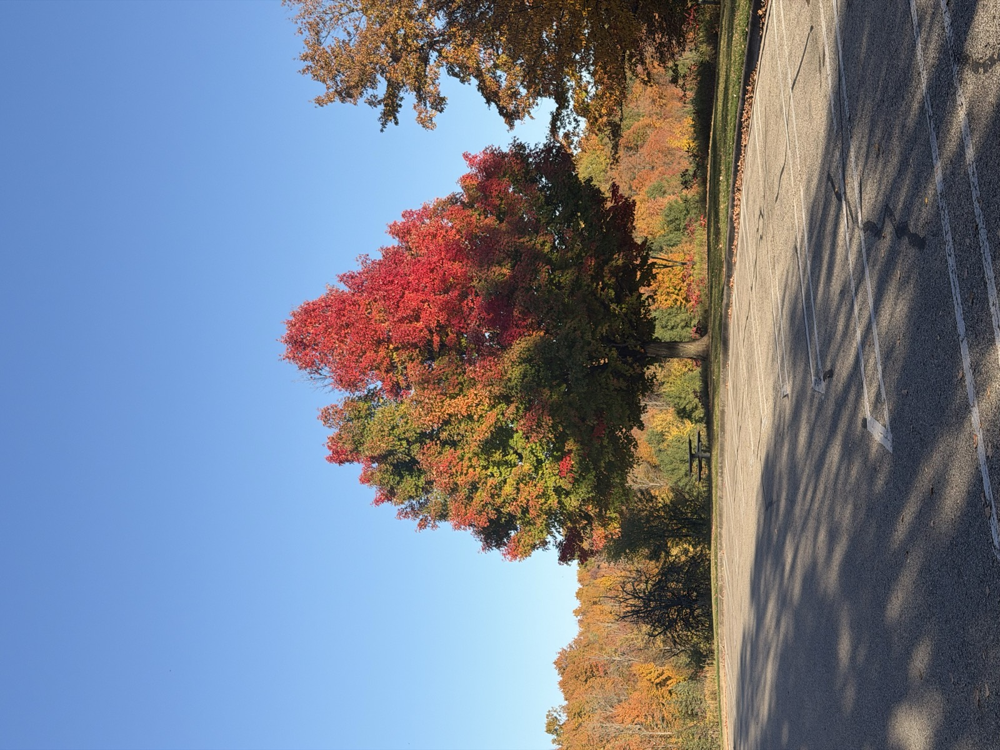

<!-- To add a photo: drop it in images/photos/ and add one line below.
     Format: {group="photos" fig-alt="Description"} -->

::: {.photo-grid}
{group="photos" fig-alt="Snow-capped mountain range above a layer of low cloud, with evergreen trees in the foreground"}

{group="photos" fig-alt="Looking straight up from a rocky gorge at a sky of rippled clouds, framed by evergreen and autumn trees"}

{group="photos" fig-alt="A maple tree turning red and orange against a clear blue sky, beside an empty parking lot"}
:::
