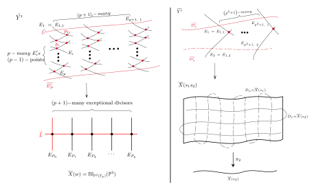
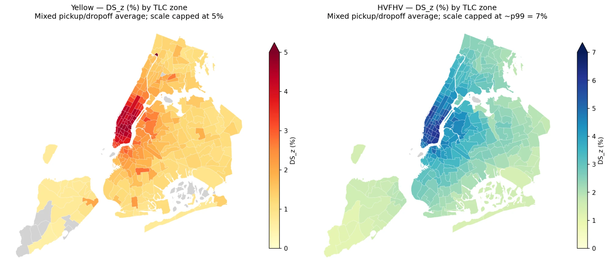

My research focuses on problems in **arithmetic geometry** and **representation
theory**. My current interests are:

- **Galois module structure:** how Galois groups act on the cohomology of algebraic varieties
- **Deligne–Lusztig varieties:** their explicit geometry and Galois module structure
- **Computational aspects of Drinfeld modules**
- **Arithmetic statistics** of class groups of number fields

## Dissertation

::: {.entry}
### Galois module structure of Deligne–Lusztig varieties

[In progress · Michigan State University · Advisor: Georgios Pappas]{.entry-meta}
:::

## Research articles

::: {.entry}
### [Galois module structure of Deligne–Lusztig varieties for $\mathbf{G} = \mathrm{GL}_3$](research/dl-gl3.qmd)

[Preprint, October 2026 · arXiv:2610.40335 [math.AG]]{.entry-meta}

::: {.entry-links}
[<i class="ai ai-arxiv"></i> arXiv](https://arxiv.org/abs/2610.40335)
[<i class="bi bi-file-earmark-pdf"></i> PDF](https://arxiv.org/pdf/2610.40335)
[<i class="bi bi-journal-text"></i> Summary](research/dl-gl3.qmd)
[<i class="bi bi-easel"></i> Slides](files/dl-gl3-slides.pdf)
[<i class="bi bi-image"></i> Poster](files/dl-gl3-poster.pdf)
:::

::: {.entry-body}
::: {.entry-wrap}
::: {.entry-figure}
[{fig-alt="Diagram of the resolutions of the compactified Deligne–Lusztig surfaces: on the left, the split case for GL3 over F_p, with the blown-up projective plane and its exceptional divisors; on the right, the non-split unitary case, with the ruled surface over the curve X-bar of s2."}](research/dl-gl3.qmd#method)
:::

The paper computes Lefschetz numbers for the torus action on the coherent cohomology of
compactified Deligne–Lusztig surfaces for $\mathrm{GL}_3(\mathbb{F}_p)$ and
$\mathrm{U}_3(\mathbb{F}_p)$. These numbers determine the virtual representation of
the covering group $T^{wF}$ on the alternating sum of the cohomology groups of the
structure sheaf.

The method resolves the singularities étale-locally, which leads to toric geometry; the
Hirzebruch–Jung algorithm then supplies what is needed to apply the
Lefschetz–Riemann–Roch theorem. One consequence is that the equivariant Euler
characteristic of the compactification is not virtually free over the covering group.
:::
:::
:::

::: {.entry}
### Galois module structure of Deligne–Lusztig varieties for $\mathrm{GL}_n$

[In preparation]{.entry-meta}
:::

## Master's thesis

::: {.entry}
### Class field theory (“Study of finite abelian extensions of $\mathbb{Q}$”)

[2022 · IISER Tirupati · Advisor: D. S. Nagaraj]{.entry-meta}

::: {.entry-links}
[<i class="bi bi-file-earmark-pdf"></i> Thesis](files/ms-thesis-class-field-theory.pdf)
[<i class="bi bi-easel"></i> Defense slides](files/ms-thesis-defense-slides.pdf)
:::
:::

## Projects

::: {.entry}
### Arithmetic statistics of $p$-torsion in class groups of quartic number fields

[2026–present · *Arithmetic Geometry at UNT 2*, University of North Texas · Sameera Vemulapalli's project group]{.entry-meta}

::: {.entry-links}
[<i class="bi bi-github"></i> Repository](https://github.com/s-adithya/agunt2_project)
:::

::: {.entry-body}
We study $p$-torsion in class groups of quartic number fields that admit an integral
basis of the form $1, x, y, xy$, in connection with Bhargava's parametrizations of
quartic rings. The repository has some Magma code and preliminary analysis.
:::
:::

::: {.entry}
### Efficient computation of the Weil pairing for Drinfeld modules

[2026–present · *Rethinking Number Theory* (online, June 22–July 3, 2026) · Antoine Leudière's project group]{.entry-meta}

::: {.entry-body}
We're working toward explicit computation of Weil pairings for Drinfeld modules by
implementing pairing algorithms in SageMath and other open-source software.
:::
:::

::: {.entry}
### Who bears the congestion price?

[Summer 2026 · Erdős Institute Data Science Boot Camp]{.entry-meta}

::: {.entry-links}
[<i class="bi bi-github"></i> Repository](https://github.com/Erdos-Projects/summer26-congestion-pricing)
:::

::: {.entry-body}
On January 5, 2025, New York became the first US city to charge vehicles for entering
a defined zone: the Manhattan Central Business District south of 60th Street. Using
public TLC trip records (about 37M Yellow taxi trips and about 202M Uber/Lyft trips,
February–June 2024 compared with the same months of 2025), we ask who bears this fee
and whether it reduced trips.

- **The burden is uneven, and the finding is stable.** A flat per-trip fee is a much
  larger share of short, low-cost trips, which are concentrated in the dense Manhattan
  core, than of long airport trips. The zone ranking stays stable across the tested
  denominator floors, giving a reusable, reproducible burden metric ($DS_z$).
- **The volume models show suggestive negative patterns.** Three
  regression-with-controls designs compare burden, exposure, and vehicle groups. A
  2023→2024 no-fee placebo and sensitivity checks limit a direct fee-caused
  interpretation.

::: {.entry-figure}
[{fig-alt="Two choropleth maps of New York City's TLC taxi zones. Left: Yellow taxi fee burden DS_z, shaded light yellow to dark red on a 0 to 5 percent scale. Right: Uber/Lyft (HVFHV) fee burden, shaded light green to dark blue on a 0 to 7 percent scale. In both maps the burden is highest in Manhattan below Central Park and decreases toward the outer boroughs and Staten Island."}](images/research/congestion-ds-z-maps.webp)
:::
:::
:::

## Seminars

- **Co-organizer**, Student Algebra Seminar, Michigan State University (Fall 2024, Spring 2025)
- **Participant** at MSU: Agentic AI Seminar (Fall 2026), Lean Seminar (Spring and Fall 2026),
  Étale Cohomology Learning Seminar (2025–26), Class Number One Problem Learning Seminar
  (Spring 2025), Class Field Theory Learning Seminar (Summer 2023)
