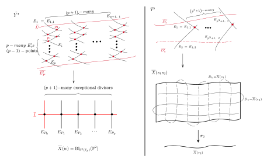

[Draft, October 2026. Comments are welcome. An arXiv link will be added when the preprint is posted.]{.entry-meta}

<!-- When the preprint is on arXiv, add a button like:
[arXiv](https://arxiv.org/abs/XXXX.XXXXX){.btn .btn-primary .btn-sm} -->
[Draft (PDF)](../files/dl-gl3-draft.pdf){.btn .btn-primary .btn-sm}
[Slides (AMS, Oct 2026)](../files/dl-gl3-slides.pdf){.btn .btn-outline-primary .btn-sm}
[Poster (Utah, Aug 2026)](../files/dl-gl3-poster.pdf){.btn .btn-outline-primary .btn-sm}
[Talks on this work](#talks){.btn .btn-outline-secondary .btn-sm}

## Abstract

Let $\overline{Y(w)} \to \overline{X(w)}$ be the ramified Galois cover of compactified
Deligne–Lusztig varieties. Our objects of study are the Lefschetz numbers for the action
of the finite covering group $\mathbf{T}^{wF}$ on the coherent cohomology of the structure
sheaf of $\overline{Y(w)}$. The full collection of Lefschetz numbers determines the
virtual representation of $\mathbf{T}^{wF}$ on the alternating sum of these cohomology
groups. In the two cases of Deligne–Lusztig surfaces of type $A_2$ and ${}^2A_2$, we give
explicit formulas for the Lefschetz numbers for a generator of the stabilizer of an
irreducible component. It follows that the equivariant Euler characteristic of the
compactification $\overline{Y(w)}$ is not virtually free as a virtual module over the
covering group.

## Summary

Deligne and Lusztig defined a finite étale cover $Y(w) \to X(w)$ of varieties. It is
attached to any connected reductive group $\mathbf{G}$ defined over a finite field
$\mathbb{F}_q$, with a Frobenius endomorphism $F$, and to a Weyl group element
$w \in W$.

We consider the ramified Galois covers
$$
\overline{Y(w)} \longrightarrow \overline{X(w)}
$$
of the natural compactifications of these Deligne–Lusztig varieties. Our goal is to
calculate the Lefschetz numbers for the action of the covering group on the coherent
cohomology of the structure sheaf of $\overline{Y(w)}$. The covering group is
$\mathbf{T}^{wF}$, the $\mathbb{F}_p$-points of a torus.

These numbers determine the representation of $\mathbf{T}^{wF}$ on the alternating sum
$$
\sum_i (-1)^i \, H^i\big(\overline{Y(w)}, \mathcal{O}_{\overline{Y(w)}}\big).
$$
The paper gives these Lefschetz numbers explicitly for Deligne–Lusztig surfaces, in
the cases $\mathbf{G}^F = \mathrm{GL}_3(\mathbb{F}_p)$ and
$\mathbf{G}^F = \mathrm{U}_3(\mathbb{F}_p)$.

## Method

The approach is to work étale-locally to resolve the singularities of
$\overline{Y(w)}$, and to construct a smooth model carrying an action of
$\mathbf{T}^{wF}$ that extends the action on $\overline{Y(w)}$. The local
calculations lead to toric geometry. The Hirzebruch–Jung algorithm for minimal
resolutions of toric surfaces then supplies what is needed to apply the
Lefschetz–Riemann–Roch theorem. In both the split and the unitary case, the resulting
Lefschetz numbers are explicit and nonzero.

::: {.math-figure}
{#fig-resolutions fig-alt="Diagram of the resolutions of the compactified Deligne–Lusztig surfaces: on the left, the split case for GL3 over F_p, with the blown-up projective plane and its exceptional divisors; on the right, the non-split unitary case, with the ruled surface over the curve X-bar of s2."}
:::

## Background: geometric Galois module theory

Geometric Galois module theory studies how a finite group acting on an algebraic
variety or scheme gives module structures on its cohomological and arithmetic
invariants. If a finite group $G$ acts on a variety $X$, then $G$ acts naturally on
cohomology groups such as $H^i(X, \mathcal{F})$. These groups can then be studied as
modules over the group ring $k[G]$, or over the corresponding integral group rings in
arithmetic settings.

A central problem is to determine these module structures, and their equivariant
Euler characteristics, for a Galois cover $X \to X/G$. This extends classical Galois
module theory to higher dimensions. In the classical theory, one studies rings of
integers in finite Galois extensions of local or global fields as modules over group
rings.

The subject draws on arithmetic geometry, algebraic geometry, representation theory,
and algebraic $K$-theory. Ramification and fixed-point data play a central role in
the structure of the resulting Galois modules.

## Talks {#talks}

- Group, Lie and Number Theory Seminar, University of Michigan · November 2026 *(scheduled)*
- Poster, AGNES, Brown University · November 21, 2026 *(scheduled)*
- Graduate Student Lecture Series (UBDoG), University at Buffalo · October 2026 *(scheduled)*
- AMS Special Session on Springer Fibers, Harmonic Analysis, and Arithmetic,
  George Washington University · October 4, 2026 · [slides](../files/dl-gl3-slides.pdf)
- Automorphic Forms and Representation Theory Seminar, Purdue University · September 2026
- Poster, The Australian Direction, University of Utah · August 11, 2026 · [poster](../files/dl-gl3-poster.pdf)
- GTA Philly, Temple University · May 30, 2026
